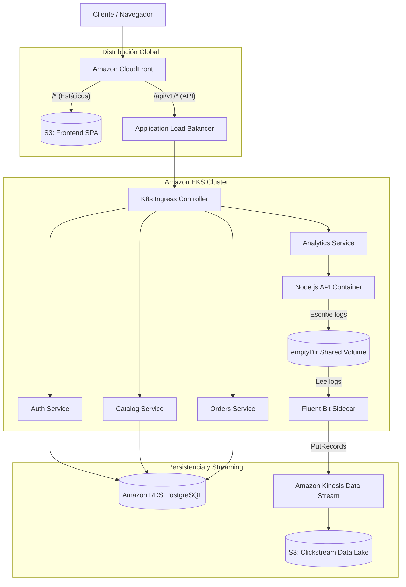

# Propuesta Arquitectónica: Migración a Microservicios con Amazon EKS y CloudFront

**Proyecto:** BookStore Co.  
**Entorno de despliegue:** AWS Academy Learner Lab

---

## 1. Resumen Ejecutivo y Objetivo

El objetivo de esta propuesta es modernizar la arquitectura de **BookStore Co.** desacoplando el frontend y dividiendo el backend monolítico actual en microservicios independientes.

- **Frontend:** Se desacopla del contenedor Nginx actual y pasa a ser una Single Page Application (SPA) estática servida globalmente con **Amazon CloudFront** y almacenada en **Amazon S3**.
- **Backend:** El monolito Node.js/Express se descompone en 4 microservicios orquestados dentro de un clúster de **Amazon EKS (Kubernetes)**.
- **Sidecar / Streaming:** Se mantiene la funcionalidad del laboratorio de streaming (Fluent Bit $\to$ Kinesis $\to$ S3) ahora como un contenedor sidecar nativo de un Pod en Kubernetes.

---

## 2. Diagrama de Arquitectura

### 2.1. Vista Esquemática (Compatible con cualquier visor)

```text
+-----------------------------------------------------------------------------------+
|                              Cliente / Navegador Web                              |
+-----------------------------------------------------------------------------------+
                                          |
                                          v
+-----------------------------------------------------------------------------------+
|                        Amazon CloudFront (CDN / Edge)                             |
|  - Dominio único: https://tuapp.com                                               |
|  - Comportamiento /*        --> Origen: S3 (Frontend SPA estático)                |
|  - Comportamiento /api/v1/* --> Origen: ALB de EKS (Sin problemas de CORS)        |
+-----------------------------------------------------------------------------------+
         |                                                 |
         | (Archivos estáticos)                            | (Llamadas API /api/v1/*)
         v                                                 v
+-----------------------------+       +---------------------------------------------+
|    Amazon S3 (Bucket)       |       |       Application Load Balancer (ALB)       |
|  - HTML, JS compilado, CSS  |       +---------------------------------------------+
|  - Acceso privado vía OAC   |                              |
+-----------------------------+                              v
                                      +---------------------------------------------+
                                      |         Amazon EKS Cluster (VPC)            |
                                      |                                             |
                                      |  +---------------------------------------+  |
                                      |  |       K8s Ingress Controller          |  |
                                      |  +---------------------------------------+  |
                                      |        |          |          |          |   |
                                      |        v          v          v          v   |
                                      |     [Auth]    [Catalog]   [Orders]  [Analytics]
                                      |        |          |          |          |   |
                                      |        |          |          |     +--------+
                                      |        |          |          |     | (Pod)  |
                                      |        |          |          |     | NodeAPI|
                                      |        |          |          |     |   |    |
                                      |        |          |          |     | emptyDir
                                      |        |          |          |     |   |    |
                                      |        |          |          |     | Fluent |
                                      |        |          |          |     |  Bit   |
                                      +--------|----------|----------|---------|----+
                                               |          |          |         |
                                               v          v          v         |
                        +--------------------------------------------+         |
                        |         Amazon RDS PostgreSQL              |         |
                        |  - customers | books | orders | items      |         |
                        +--------------------------------------------+         |
                                                                               v
                                                          +-------------------------+
                                                          | Amazon Kinesis Stream   |
                                                          +-------------------------+
                                                                       |
                                                                       v
                                                          +-------------------------+
                                                          |  Amazon S3 (Data Lake)  |
                                                          +-------------------------+
```

### 2.2. Diagrama Mermaid (Para GitHub / Visores con soporte Mermaid)



> [!NOTE]
> **¿Por qué VS Code no renderiza bloques `mermaid` por defecto?**  
> El visor nativo de Markdown de VS Code (`Ctrl + Shift + V`) no incluye el motor de renderizado de Mermaid de fábrica. Para verlo renderizado gráficamente dentro de VS Code basta con instalar la extensión oficial: **`Markdown Preview Mermaid Support`** (de Matt Bierner) desde la pestaña de Extensiones (`Ctrl + Shift + X`). En plataformas como GitHub, GitLab o Notion se renderiza de forma automática.

## 3. Descomposición de Componentes

### 3.1. Frontend (Amazon S3 + CloudFront)

- **Despliegue estático:** En lugar de pagar por un contenedor Nginx 24/7 en ECS/EKS, se ejecuta `npm run build` en el frontend y se suben los archivos de `dist/` a un bucket S3 privado.
- **CloudFront con OAC (Origin Access Control):** Solo CloudFront tiene permiso para leer el bucket S3.
- **Eliminación de problemas de CORS:** CloudFront maneja tanto el contenido estático como la API bajo el mismo dominio:
  - `/*` $\to$ Origen: S3 (con error document a `index.html` para la SPA).
  - `/api/v1/*` $\to$ Origen: Ingress / ALB de EKS.

---

### 3.2. Microservicios del Backend (Amazon EKS)

El código de `backend/` se fragmenta en 4 repositorios/imágenes Docker independientes:

| Microservicio         | Responsabilidad y Rutas                                                    | Persistencia / Integraciones                                          |
| :-------------------- | :------------------------------------------------------------------------- | :-------------------------------------------------------------------- |
| **Auth Service**      | `/api/v1/auth`: Registro, login, sesiones de clientes.                     | Tabla `customers` en PostgreSQL.                                      |
| **Catalog Service**   | `/api/v1/books`: Listado de libros, búsqueda, consulta de stock y detalle. | Tabla `books` en PostgreSQL.                                          |
| **Orders Service**    | `/api/v1/orders`: Creación y consulta de órdenes y líneas de pedido.       | Tablas `orders` y `order_items`.                                      |
| **Analytics Service** | `/api/v1/events`: Ingesta de eventos de clickstream y navegación.          | Escribe en disco compartido (`emptyDir`) hacia el sidecar Fluent Bit. |

---

## 4. Retos Técnicos Principales

1. **Ruptura de la Transacción ACID en Órdenes:**
   - _Situación actual:_ `orderService.js` ejecuta una única transacción SQL en PostgreSQL que valida el cliente, bloquea el stock de libros (`SELECT FOR UPDATE`), descuenta existencias y genera la orden.
   - _En microservicios:_ Se pierde la transacción atómica única. Se requiere implementar el patrón **Saga** o llamadas de validación/reserva entre servicios (por ejemplo, `Orders` solicita validación a `Catalog` antes de confirmar).
2. **Sidecar en Kubernetes:**
   - Es más simple que en ECS: dentro del manifiesto del Pod de `Analytics`, se declaran ambos contenedores (`node-api` y `fluent-bit`) montando el mismo volumen efímero `emptyDir`.
3. **Service Discovery Interno:**
   - Los servicios se comunican internamente vía DNS de Kubernetes:  
     `http://catalog-service.bookstore.svc.cluster.local:5001`.

---

## 5. Consideraciones Críticas para AWS Academy

Dado que trabajamos con cuentas de **AWS Academy Learner Lab**, existen restricciones técnicas y financieras obligatorias a considerar:

> [!WARNING]
>
> ### 1. Presupuesto de Créditos ($50 - $100 USD límite)
>
> - **Costo fijo de EKS:** El plano de control de un clúster EKS cuesta **$0.10 USD por hora** (~$2.40 USD/día $\approx$ **$73 USD al mes**), **sin contar los nodos EC2**.
> - Dejar el clúster encendido por más de dos o tres semanas consumirá la totalidad de los créditos del laboratorio.
> - **Regla de oro:** Se deben crear scripts de automatización (`eksctl create cluster` / `eksctl delete cluster`) y **destruir o apagar el clúster** cuando no se esté trabajando.

> [!IMPORTANT]
>
> ### 2. Restricciones de IAM (Uso estricto de `LabRole`)
>
> - En AWS Academy **no está permitido crear nuevos IAM Roles ni IAM Policies**.
> - No se puede utilizar _EKS Pod Identity_ ni _IRSA (IAM Roles for Service Accounts)_ tradicionales porque requieren crear proveedores OIDC y roles específicos.
> - **Solución en Academy:** Los nodos EC2 del clúster de EKS deben instanciarse asociando el rol preexistente **`LabRole`** (o `arn:aws:iam::<ACCOUNT_ID>:role/LabRole`), el cual ya posee permisos sobre ECR, S3, Kinesis y CloudWatch.

> [!NOTE]
>
> ### 3. Límites de vCPU y Tipos de Instancia
>
> - AWS Academy limita la cantidad de vCPUs concurrentes (habitualmente máximo 32 vCPUs por región).
> - Se recomienda usar un grupo de nodos pequeño (por ejemplo, 2 instancias `t3.medium` o `t3a.medium`) para albergar todos los pods y no saturar la cuota ni los créditos.

---

## 6. Plan de Implementación Recomendado (Fases)

1. **Fase 1 (Frontend Serverless):**
   - Configurar el bucket S3 para el frontend y la distribución CloudFront con OAC. Apuntar `/api/*` al balanceador actual. _(Costo casi nulo y ganancia inmediata de rendimiento)._
2. **Fase 2 (Extracción de Analytics con Sidecar a EKS):**
   - Extraer primero el servicio de `events` y desplegarlo en EKS con el sidecar de Fluent Bit. Como no depende de la base de datos relacional, valida la integración con Kinesis/S3 sin riesgo transaccional.
3. **Fase 3 (Extracción de Catalog y Auth):**
   - Separar los servicios de lectura y autenticación.
4. **Fase 4 (Orders y Consistencia):**
   - Implementar la lógica distribuida de creación de órdenes y reserva de stock entre `Orders` y `Catalog`.
